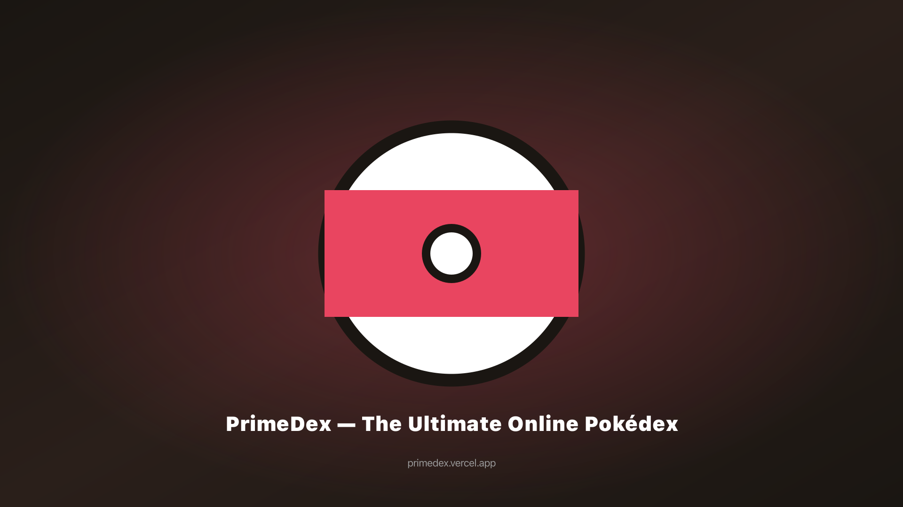
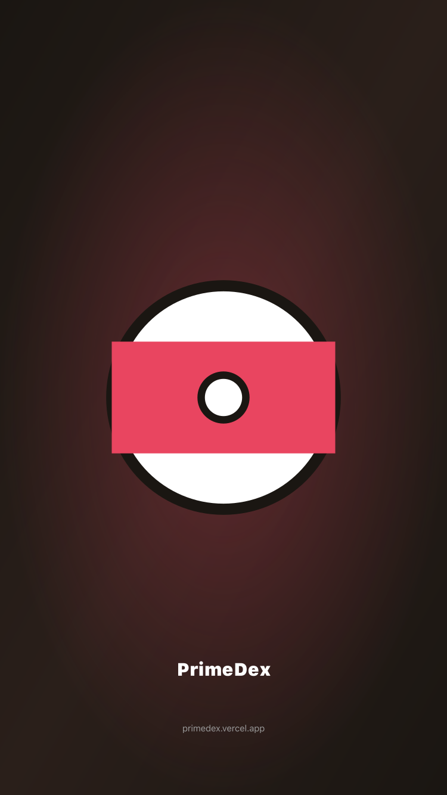

<!-- prettier-ignore -->
<div align="center">


# Lunidex

**Un espace Pokémon dédié aux joueurs, dresseurs et collectionneurs TCG.**

[](https://lunidex.app)
[](https://github.com/teefloo/Lunidex/actions/workflows/ci.yml)
[](https://nodejs.org/)
[](https://nextjs.org/)
[](https://react.dev/)
[](https://www.typescriptlang.org/)

[Application en ligne](https://lunidex.app) · [Dépôt](https://github.com/teefloo/Lunidex) · [Issues](https://github.com/teefloo/Lunidex/issues)

[Vue d’ensemble](#vue-densemble) · [Fonctionnalités](#fonctionnalités) · [Démarrage rapide](#démarrage-rapide) · [Configuration](#configuration) · [Architecture](#architecture) · [Déploiement](#déploiement)



</div>

<!-- README-I18N:START -->

[English](./README.md) · **Français** · [Español](./README.es.md) · [Deutsch](./README.de.md) · [Italiano](./README.it.md) · [日本語](./README.ja.md) · [한국어](./README.ko.md) · [中文](./README.zh.md) · [Português](./README.pt.md)

<!-- README-I18N:END -->

## Vue d’ensemble

Lunidex est un monorepo npm-workspaces open source et indépendant centré sur le suivi de collection Pokémon TCG, avec un Pokédex, des outils de création d’équipes et un espace personnel lié à un compte.

L’application web expose les fiches Pokémon renvoyées par sa source PokéAPI configurée et prend en charge huit langues d’interface : anglais, français, espagnol, allemand, italien, japonais, coréen et chinois simplifié. Le portugais est disponible comme traduction du README, mais ne fait pas partie des langues de l’interface web.

Les pages de référence publiques sont accessibles sans compte. L’espace personnel — favoris, Pokémon capturés, équipes, progression du quiz, collections TCG, listes de souhaits, recherches enregistrées, notes, decks et fonctions associées — utilise Supabase Auth et Supabase PostgreSQL lorsqu’ils sont configurés et synchronisés. Les préférences d’affichage web utilisent IndexedDB.

> [!NOTE]
> Lunidex est un projet de fans indépendant et non officiel. Les noms de personnages Pokémon, marques, illustrations, images et propriété intellectuelle associée appartiennent à leurs détenteurs respectifs. Lunidex n’est ni affilié à Nintendo, Creatures Inc., GAME FREAK inc. ou The Pokémon Company, ni approuvé, sponsorisé ou officiellement lié à ces sociétés.

<div align="center">
  
</div>

## Fonctionnalités

| Domaine | Ce que vous pouvez faire |
| --- | --- |
| **Pokédex et référence** | Parcourir et filtrer les fiches Pokémon fournies par la source de données configurée ; consulter statistiques, types, capacités, attaques, évolutions, formes, rencontres, sprites et données d’espèce localisées. Rechercher des attaques, capacités et objets. |
| **Laboratoire d’équipes et de combats** | Créer des équipes de six Pokémon maximum, analyser la couverture des types et des attaques, examiner la synergie et les rôles, comparer jusqu’à trois Pokémon, utiliser le tableau des 18 types, planifier les EV/IV, calculer la reproduction et lancer un simulateur de combats de génération 9. |
| **Progression et jeu** | Suivre les favoris, les Pokémon capturés, la Living Dex, l’activité, les badges et les statistiques du quiz. Jouer avec trois défis et trois modes de quiz, dont des parties quotidiennes, et suivre une partie Nuzlocke. |
| **Partage et fonctions sociales** | Importer et exporter des équipes Showdown, partager des liens d’équipe en lecture seule, créer un profil public, gérer ses amis, consulter les classements du quiz et utiliser les salons de combat liés au compte. |
| **Espace Pokémon TCG** | Parcourir cartes et extensions, filtrer le catalogue, comparer des cartes, suivre les cartes possédées et recherchées, consulter la progression par extension, enregistrer recherches et notes, construire des decks et afficher les champs de prix lorsque TCGdex les fournit. |
| **PWA et persistance** | Installer l’application web comme PWA. Le service worker met en cache le shell de l’application et certaines ressources amont pour faciliter les visites répétées, tandis que les données de compte restent derrière l’API serveur. |

## Explorer l’application

Remplacez `en` par une langue prise en charge : `en`, `fr`, `es`, `de`, `it`, `ja`, `ko` ou `zh`.

| Surface | Route |
| --- | --- |
| Accueil | [`/en`](https://lunidex.app/en) |
| Pokédex | [`/en/pokedex`](https://lunidex.app/en/pokedex) |
| Fiche Pokémon | [`/en/pokemon/pikachu`](https://lunidex.app/en/pokemon/pikachu) |
| Créateur d’équipe | [`/en/team`](https://lunidex.app/en/team) |
| Tableau des types | [`/en/types`](https://lunidex.app/en/types) |
| Quiz | [`/en/quiz`](https://lunidex.app/en/quiz) |
| Simulateur de combat | [`/en/battle`](https://lunidex.app/en/battle) |
| Catalogue TCG | [`/en/tcg`](https://lunidex.app/en/tcg) |
| Collection TCG | [`/en/tcg/collection`](https://lunidex.app/en/tcg/collection) |
| Tableau de bord | [`/en/dashboard`](https://lunidex.app/en/dashboard) |

Les surfaces de collection, de tableau de bord, sociales et autres espaces personnels peuvent nécessiter une session de synchronisation authentifiée.

## Démarrage rapide

### Prérequis

- [Node.js](https://nodejs.org/) 22
- npm et le fichier `package-lock.json` versionné
- [Git](https://git-scm.com/)

Clonez le dépôt, installez les workspaces et démarrez l’application web :

```bash
git clone https://github.com/teefloo/Lunidex.git
cd Lunidex
npm ci
npm run dev
```

Ouvrez [http://localhost:3000](http://localhost:3000). Le proxy de localisation redirige une URL sans préfixe vers une langue prise en charge comme `/fr`, en utilisant le cookie `primedex-lang` ou la langue du navigateur lorsqu’elle est disponible.

> [!IMPORTANT]
> Les builds de développement et de production utilisent volontairement webpack : `npm run dev` exécute `next dev --webpack` et `npm run build` exécute `next build --webpack`. Conservez cette option même si la configuration Next.js déclare aussi une racine Turbopack.

## Configuration

Aucune variable d’environnement n’est nécessaire pour consulter les pages de référence publiques. Copiez le modèle pour activer les intégrations facultatives de compte, serveur, contact, notifications ou développement :

```bash
cp .env.example .env.local
```

| Variable(s) | Portée | Rôle |
| --- | --- | --- |
| `NEXT_PUBLIC_APP_URL` | Web / public | URL canonique du site et base API. Par défaut : `https://lunidex.app`. |
| `NEXT_PUBLIC_SUPABASE_URL`, `NEXT_PUBLIC_SUPABASE_PUBLISHABLE_KEY` | Web / public | Configuration Supabase Auth utilisée par le client navigateur et le rendu serveur. |
| `SUPABASE_DATABASE_URL` | Serveur uniquement | Connexion PostgreSQL Supabase du runtime. Utiliser le pooler partagé en mode session avec TLS vérifié. |
| `SUPABASE_SERVICE_ROLE_KEY` | Server-only | Administration Auth côté serveur uniquement; ne jamais transmettre au navigateur. |
| `NEXT_PUBLIC_GOOGLE_VERIFICATION` | Web / public | Valeur facultative de validation Google Search Console. |
| `NEXT_PUBLIC_ENABLE_AGENTATION` | Développement | Active l’overlay de revue UI Agentation lorsque la valeur est `true`. |
| `NEXT_PUBLIC_VAPID_PUBLIC_KEY` | Web / public | Clé facultative d’abonnement aux notifications push du navigateur. |
| `LUNIDEX_VAPID_PRIVATE_KEY`, `LUNIDEX_VAPID_SUBJECT` | Serveur uniquement | Configuration facultative de livraison des notifications push côté serveur. |
| `RESEND_API_KEY`, `CONTACT_TO_EMAIL`, `CONTACT_FROM_EMAIL` | Serveur uniquement | Envoi facultatif du formulaire de contact via Resend. |
| `NEON_SOURCE_DATABASE_URL`, `SUPABASE_MIGRATION_DATABASE_URL`, `SUPABASE_PROJECT_REF` | Migration uniquement | Export ponctuel de la source Neon vers un projet Supabase explicitement choisi. |

> N’exposez jamais les chaînes de connexion, paramètres JWKS, secrets de cookie, clés privées VAPID, clés Resend ou URL de migration via `NEXT_PUBLIC_*`, des fichiers source, des logs ou des commits.

<details>
<summary><strong>Activer Agentation en développement</strong></summary>

Ajoutez cette valeur dans `.env.local`, puis redémarrez le serveur de développement :

```dotenv
NEXT_PUBLIC_ENABLE_AGENTATION=true
```

L’outil utilise `http://localhost:4747` ; son origine de développement et son support CSP sont déjà configurés.

</details>

## Scripts

Exécutez les commandes racine depuis la racine du dépôt :

| Commande | Description |
| --- | --- |
| `npm run dev` | Démarre le serveur de développement Next.js. |
| `npm run build` | Crée un build de production. |
| `npm run start` | Sert le build de production. |
| `npm run lint` | Analyse les sources web et core. |
| `npm run typecheck` | Vérifie le workspace web. |
| `npx tsc --project packages/core/tsconfig.json --noEmit` | Vérifie `@primedex/core`. |
| `npm run db:migrate:supabase:export` | Exporte la source Neon en lecture seule. |
| `npm run db:migrate:supabase:dry-run` | Vérifie la cible choisie sans écrire. |
| `npm run db:migrate:supabase:auth` | Importe les UUID Auth; les utilisateurs devront réinitialiser leur mot de passe. |
| `npm run db:migrate:supabase:data` | Importe les données dans une cible vide. |
| `npm run db:migrate:supabase:verify` | Compare les tables, clés, séquences, checksums et identités Auth. |


Le workflow CI dans `.github/workflows/ci.yml` installe les dépendances, lance le lint, les vérifications de types, le contrôle SEO et le build de production.

## Architecture

```text
.
├── src/                 Application web Next.js 16 / React 19
├── packages/core/       `@primedex/core` : types métier et helpers TCG/produits scellés
├── neon/migrations/     Schéma Neon historique
├── supabase/            Schéma actif PostgreSQL, RLS et fonction Edge archivée
├── scripts/migration/        Scripts de migration Neon vers Supabase contrôlés
├── public/              Icônes PWA, captures, ressources cartes et fichiers statiques
└── docs/                Notes produit, design, migration, audit et implémentation
```

```text
Web (Next.js App Router)
  ├── Composants de routes serveur et client
  ├── TanStack Query ──▶ clients API partagés ──▶ PokéAPI + TCGdex
  ├── Zustand ──▶ préférences d’affichage IndexedDB
  └── Route Handlers ──▶ Supabase Auth + espace utilisateur PostgreSQL Supabase

```

Principales frontières :

- **Web :** Next.js 16 App Router, React 19, TypeScript, Tailwind CSS 4, Base UI, Framer Motion, TanStack Query et couche PWA.
- **Core partagé :** l’application web utilise des types métier portables et des helpers purs TCG/produits scellés.
- **Accès aux données :** les requêtes web passent par la façade API centralisée de src/lib/api ; les composants de présentation n’ajoutent pas de clients API ad hoc.
- **Persistance :** les préférences d’affichage web utilisent IndexedDB avec un fallback navigateur. L’espace authentifié est synchronisé par l’API Supabase et stocké dans user_state.
- **Localisation :** les routes préfixées et les bundles de traduction prennent en charge `en`, `fr`, `es`, `de`, `it`, `ja`, `ko` et `zh`.

> [!IMPORTANT]
> Lunidex est le nom visible du produit, mais primedex, `@primedex/core`, `usePrimeDexStore`, les clés de stockage, les slugs de routes et les domaines publics existants sont des identifiants historiques sensibles à la compatibilité. Gardez-les inchangés sauf migration délibérée.

## Sources de données et attribution

| Source | Utilisation |
| --- | --- |
| [PokéAPI](https://pokeapi.co/) REST et GraphQL | Pokémon, textes d’espèce, statistiques, types, attaques, capacités, évolutions, rencontres et noms localisés. |
| [Sprites PokéAPI](https://github.com/PokeAPI/sprites) | Sprites de Pokémon et d’objets et ressources d’illustration associées. |
| [TCGdex](https://www.tcgdex.net/) | Cartes Pokémon TCG, extensions, raretés, images, champs de catalogue et champs de prix lorsqu’ils sont fournis. |
| [Supabase](https://supabase.com/) | Authentification facultative, état utilisateur PostgreSQL, profils, amis, classements, salons de combat et fonctions d’espace personnel côté serveur. |

La disponibilité des données amont, des traductions, des images et des prix peut évoluer. Lunidex n’est pas une marketplace de cartes et ne garantit ni valorisation de marché ni couverture d’historique des prix.

Le code source est distribué sous licence MIT dans [`LICENSE`](./LICENSE). La propriété intellectuelle Pokémon et les données tierces restent soumises à leurs détenteurs et conditions respectifs.

## Déploiement

La production Lunidex tourne sur le VPS OVHcloud avec Docker et Caddy. GitHub Actions construit et déploie des images immuables via l’environnement protégé `ovh-production`.

Consultez le [guide de production OVH](./docs/deployment/ovh-production.md) pour le déploiement, les contrôles de santé et le retour arrière.

## Documentation associée

- [Contexte produit](./PRODUCT.md)
- [Système de design](./DESIGN.md)
- [Runbook de migration Supabase](./docs/supabase-migration.md)
- [Issues GitHub](https://github.com/teefloo/Lunidex/issues)
